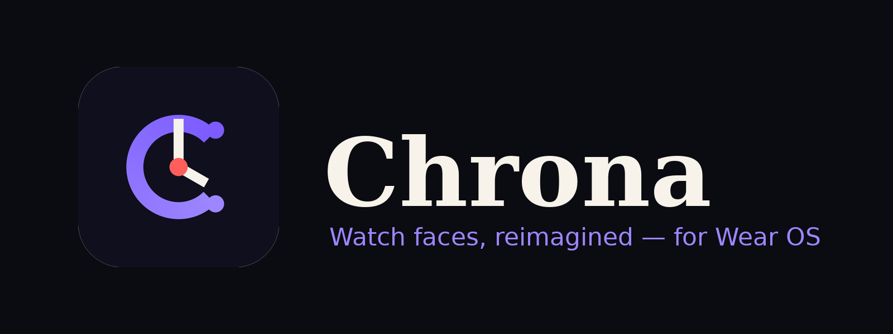

<p align="center">
  
</p>

<p align="center">
  <b>A full-stack Wear OS watch-face marketplace</b> — phone app · watch app · five Watch Face Format faces · Watch Face Push install over Bluetooth.<br/>
  Kotlin · Jetpack Compose · Compose for Wear OS (Material 3) · Hilt · Data Layer API · Watch Face Format v1–v4
</p>

---

## What it does

| Phone (`:mobile`) | Watch (`:wear`) | Faces (`:watchfaces:*`) |
|---|---|---|
| Browse a categorised catalog (Classic, Minimal, Sport, Photo, Weather) with live procedural previews | Receives APKs over a `ChannelClient` stream, verifies SHA-256, installs via **Watch Face Push** | 5 original faces in **Watch Face Format** XML — colour themes, Flavors, booleans, lists, complications, weather, photos, ambient transitions |
| One-tap *Install on watch* with transfer progress | Lists installed Chrona faces, set active / remove | Each builds to its own tiny APK (`com.chrona.watchfacepush.<id>`) |
| My Watch screen: OS version, slots, battery, permission state | Requests `PUSH_WATCH_FACES` permission | Covers WFF v1 (Wear OS 4) → v4 (Wear OS 6) |
| Favourites, search, settings synced to watch via `DataClient` | Publishes `WatchState` back to phone | Previews + hand assets generated by `scripts` |

### Wear OS compatibility

| Watch OS | Faces run? | Direct install from Chrona? |
|---|---|---|
| Wear OS 4 (API 33) | WFF v1 faces (Aurora Classic) | ✗ — publish face on Google Play |
| Wear OS 5 / 5.1 (API 34–35) | v1–v3 faces | ✗ — Play Store |
| **Wear OS 6+ (API 36)** | all faces | **✓ Watch Face Push** |

The app detects this at runtime and shows a Play Store fallback message instead of a broken install button.

## Architecture

```
┌─────────────── phone (:mobile) ───────────────┐      ┌──────────── watch (:wear) ─────────────┐
│ Compose UI ──► ChronaViewModel                 │      │ Compose for Wear UI ──► WearViewModel   │
│                 │  FaceRepository (catalog+apk)│      │                         │               │
│                 └─ WatchConnection             │      │ WatchDataLayerListenerService           │
│                    • CapabilityClient discover │◄─────┤   • onMessage  (install/remove/active)  │
│                    • MessageClient  commands  ─┼─────►│   • onChannel  (APK bytes)              │
│                    • ChannelClient  APK stream─┼─────►│ WatchSyncManager ─► WatchFaceInstaller  │
│                    • DataClient     state/prefs│◄─────┤   publishes WatchState    (Watch Face   │
└────────────────────────────────────────────────┘      │                            Push API)    │
                         ▲  shared module: DataLayerContract, models, Catalog, JSON  ▲             │
                                                        └─────────────────────────────────────────┘
```
See [`docs/ARCHITECTURE.md`](docs/ARCHITECTURE.md) for the full sequence diagram of an install.

## Quick start

```bash
git clone https://github.com/<you>/chrona && cd chrona
# Android Studio Ladybug+ · JDK 17 · SDK 36 · a Wear OS 6 emulator or watch
./gradlew :mobile:assembleDebug :wear:assembleDebug
scripts/install_debug.sh <phone-serial> <watch-serial>
```
Full setup, signing and validator steps: [`docs/SETUP.md`](docs/SETUP.md).

> **Important:** Watch Face Push requires every face APK to pass Google's validator and be signed with a *different* key than the app. `scripts/build_faces.sh` automates build → sign → validate → copy into `mobile/src/main/assets/faces/`. Until you run it, the install button will fail with a token error — that is expected.

## Repo layout

```
shared/        Data Layer contract, models, bundled catalog (used by phone + watch)
mobile/        Phone app — Compose, Material 3, Hilt, DataStore, Data Layer
wear/          Watch app — Compose for Wear OS M3, Watch Face Push, listener service
watchfaces/    5 Watch Face Format modules (XML + drawables), one APK each
assets/logo/   App logo (SVG + PNG), banner
scripts/       build_faces.sh (sign+validate), install_debug.sh
docs/          ARCHITECTURE, SETUP, DESIGN, FUTURE_ENHANCEMENTS
```

## Roadmap
See [`docs/FUTURE_ENHANCEMENTS.md`](docs/FUTURE_ENHANCEMENTS.md) — backend catalog, in-app editor, premium unlocks, tiles/complications, and more.

## License
MIT — see [LICENSE](LICENSE). Watch face designs and the Chrona logo are original work created for this project.
